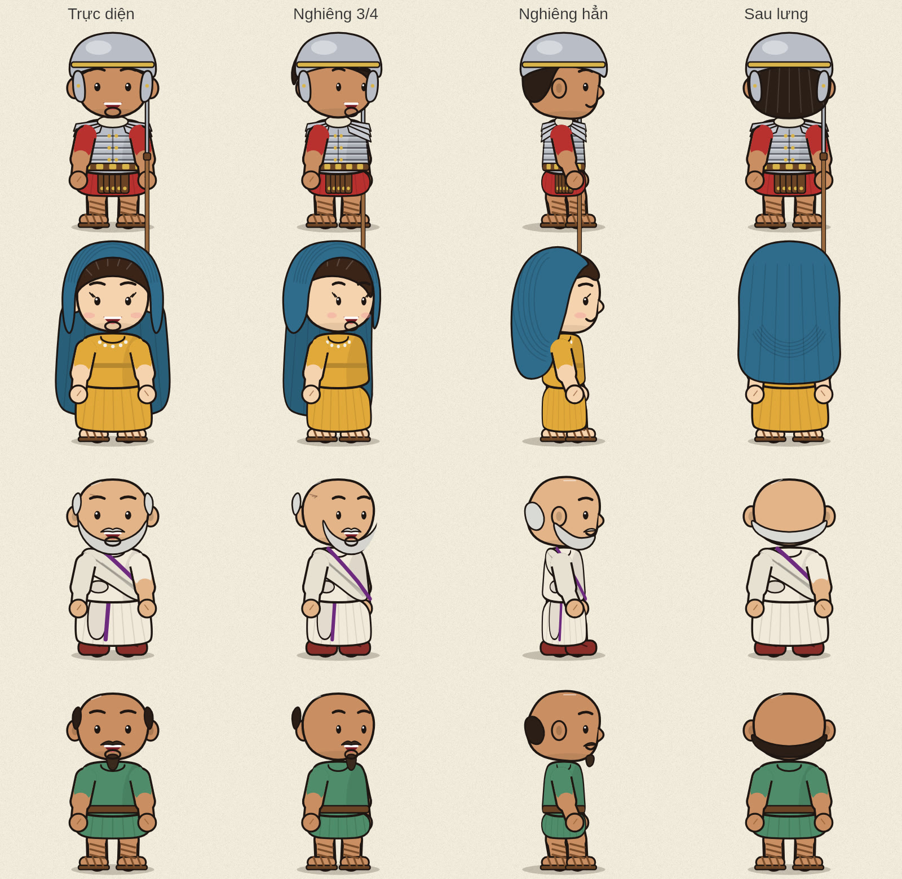

# Video bằng code: 7 skill cho Claude và các AI agent

**Một file HTML. Một video MP4.** Bộ skill này dạy AI agent làm video chuyển động hoàn toàn bằng code: không After Effects, không timeline kéo thả, không tệp âm thanh. Mọi khung hình được tính từ thời gian `t`, nên video **tái lập được 100%**, sửa một dòng là dựng lại.


## Vì sao đáng dùng
- **Tất định:** cùng `t` ra cùng một hình, không giật, không lệch giữa các lần render.
- **Chuyển động đắt tiền:** lò xo dạng công thức + lưới nhịp 120 BPM, không còn cảm giác easing mặc định của AI.
- **Tự chấm điểm:** công cụ xuất một ảnh mỗi nhịp để agent tự xem và sửa trước khi render cả phim.
- **Âm thanh bằng code:** tạo nhạc và tiếng thao tác bằng Python chuẩn, ghép thẳng vào MP4.
- **Chạy được ngay:** có file mẫu và công cụ đã kiểm thử (Node + Playwright + ffmpeg).


## 7 skill
| Skill | Làm gì |
|---|---|
| `video-bang-code` | Quy trình HTML → MP4, file mẫu, công cụ render và kiểm tra theo nhịp |
| `chuyen-dong-spring-nhip-beat` | Lò xo công thức, lưới nhịp, so le, vòng lặp mượt |
| `am-thanh-tong-hop-bang-code` | Nhạc và tiếng thao tác bằng code, tạo WAV, ghép vào video |
| `canh-3d-shader-bang-code` | Three.js, WebGL2 raymarching, render offline |
| `explainer-san-pham-bang-code` | Video giải thích sản phẩm qua 8-12 trạng thái giao diện |
| `mo-phong-tuong-tac-1-file` | Mô phỏng, game, đồ chơi trong một file HTML |
| `thu-vien-prompt-video-opus` | Danh mục 703 video cộng đồng để tìm ý tưởng và ghi công tác giả |

## Thành phẩm thật
Các cảnh dưới đây là đầu ra thật từ dây chuyền video 2D của Adam (chibi La Mã, 4 phong cách nét mực / cắt giấy / vải nỉ / đất nặn). Chúng minh hoạ mức chất lượng mà cách làm "mọi thứ là code" hướng tới.


[▶ Xem clip 14 giây (MP4)](anh/demo/caesar-giay-14s.mp4)





> Ảnh và clip demo © Adam Uses AI, đưa vào repo để minh hoạ.

## Bắt đầu nhanh
```bash
npm i playwright && npx playwright install chromium   # cần thêm ffmpeg
cd video-bang-code
node cong-cu/render.js mau/video.html ra.mp4 --w 1280 --h 720 --fps 30 --dur 8
```
Chép các thư mục skill vào thư mục skills của Claude (hoặc agent của bạn) rồi nhờ: *"làm video giới thiệu sản phẩm X dài 15 giây"*.

## Ghi nguồn
Kỹ thuật được tổng hợp lại từ bộ sưu tập cộng đồng [awesome-opus5-5-videos](https://github.com/yihui-dev/awesome-opus5-5-videos) (MIT cho phần danh sách). Prompt và video thuộc về từng tác giả; repo này **không sao chép prompt**, chỉ có danh mục tra cứu kèm link bài gốc.

## Giấy phép
[MIT](LICENSE) © 2026 Adam Uses AI

## Liên hệ
Website: https://adamusesai.com · Zalo: 0813967222 · WhatsApp: +84813967222 · hello@adamusesai.com
