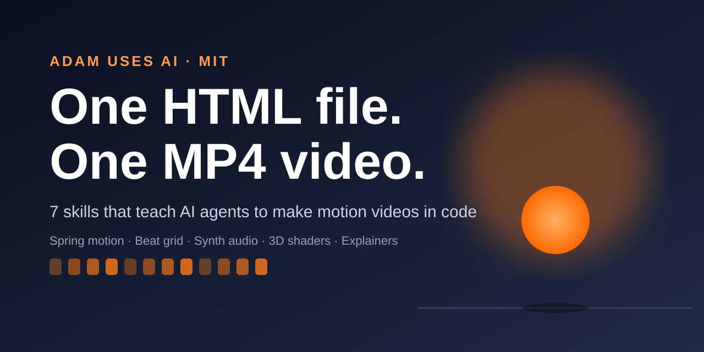
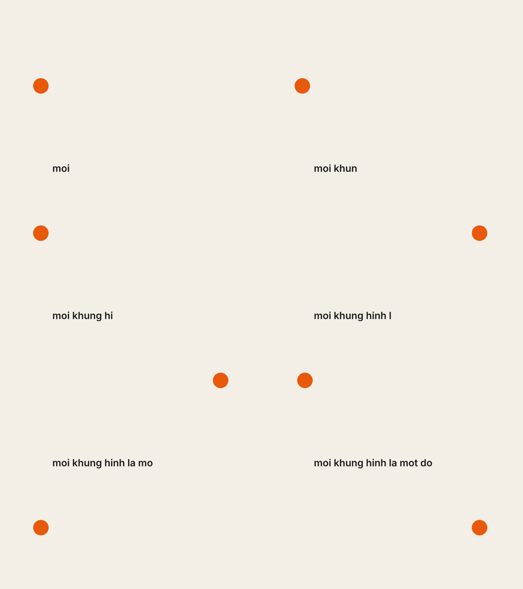
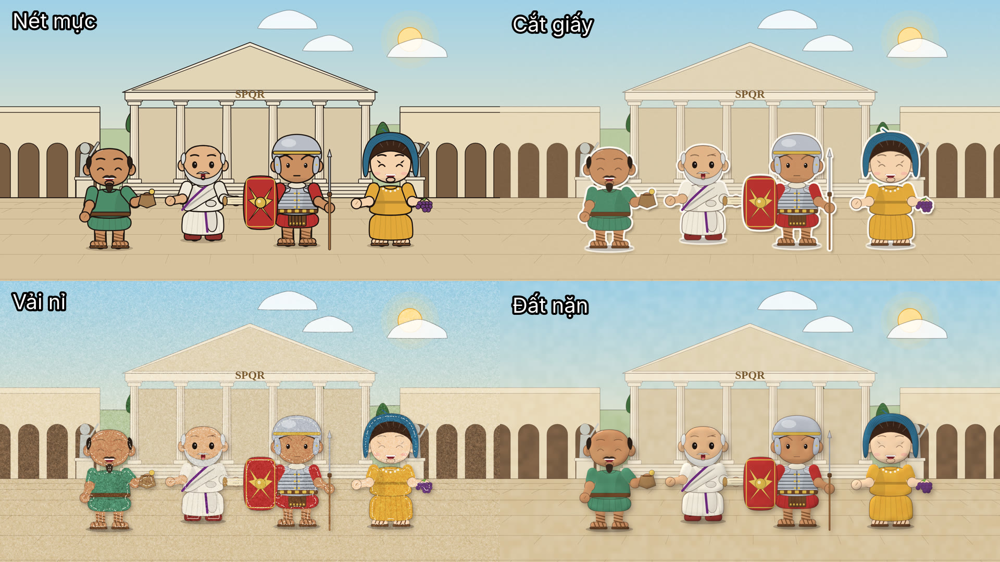
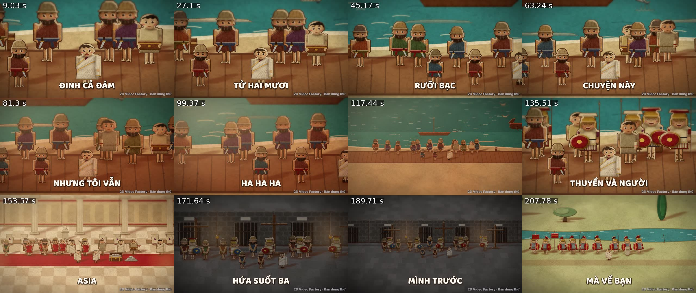

# Video-in-code: 7 skills for Claude and AI agents

**One HTML file. One MP4 video.** These skills teach an AI agent to make motion videos entirely in code: no After Effects, no drag-and-drop timeline, no audio files. Every frame is computed from time `t`, so a video is **100% reproducible**: change one line, render again.


## Why you will like it
- **Deterministic:** same `t` gives the same picture. No jitter, no drift between renders.
- **Premium motion:** closed-form springs plus a 120 BPM beat grid, so it never looks like default AI easing.
- **Self-grading:** a tool exports one still per beat so the agent can look, score and fix before rendering the whole film.
- **Sound in code:** synthesize music and UI sounds with standard-library Python and mux them straight into the MP4.
- **Works today:** ships with a template and tested tools (Node + Playwright + ffmpeg).



## The 7 skills
| Skill | What it does |
|---|---|
| `video-bang-code` | HTML to MP4 workflow, template, render and per-beat check tools |
| `chuyen-dong-spring-nhip-beat` | Closed-form springs, beat grid, stagger, seamless loops |
| `am-thanh-tong-hop-bang-code` | Music and sound effects in code, WAV generator, mux into video |
| `canh-3d-shader-bang-code` | Three.js, WebGL2 raymarching, offline render |
| `explainer-san-pham-bang-code` | Product explainer: one morphing shape through 8-12 real UI states |
| `mo-phong-tuong-tac-1-file` | Simulations, games and toys in a single HTML file |
| `thu-vien-prompt-video-opus` | Lookup catalog of 703 community videos (author, type, technique, source link) |

> The skill instructions (SKILL.md) are written in Vietnamese. Your agent can read them as they are, or ask it to translate them for you.

## Real output
These scenes come from Adam's 2D video line (chibi Rome, four looks: ink / paper cut / felt / clay). They show the quality bar this all-code approach aims for.


[Watch the 14-second clip (MP4)](anh/demo/caesar-giay-14s.mp4)






> Demo images and clips (c) Adam Uses AI, included for illustration.

## Quick start
```bash
npm i playwright && npx playwright install chromium   # ffmpeg is also required
cd video-bang-code
node cong-cu/render.js mau/video.html out.mp4 --w 1280 --h 720 --fps 30 --dur 8
```
Copy the skill folders into your Claude (or other agent) skills directory, then ask: *"Make a 15-second product intro video for X."*

## Credits
The techniques are distilled from the community collection [awesome-opus5-5-videos](https://github.com/yihui-dev/awesome-opus5-5-videos) (MIT for the list itself). Prompts and videos belong to their individual creators. This repo does **not** copy any prompt; it only contains a lookup catalog with links to the original posts.

## License
[MIT](LICENSE) (c) 2026 Adam Uses AI

## Contact
Website: https://adamusesai.com | Zalo: 0813967222 | WhatsApp: +84813967222 | hello@adamusesai.com
